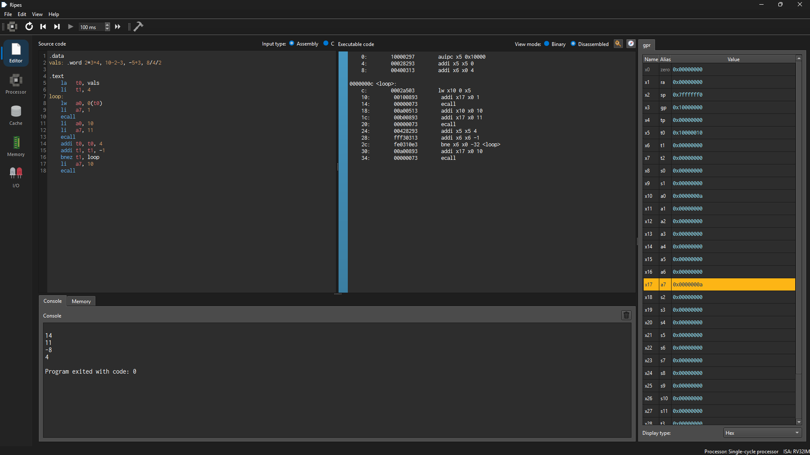

# Mach Zero Hackathon: Ripes (Team 8)

| | |
|---|---|
| Upstream repository | https://github.com/mortbopet/Ripes |
| Our fork | https://github.com/sasukeuchiha14/Ripes |
| Fix branch | [`added_precedence`](https://github.com/sasukeuchiha14/Ripes/tree/added_precedence) |
| Issue | [mortbopet/Ripes#489](https://github.com/mortbopet/Ripes/issues/489): Assembler expressions ignore operator precedence (evaluated right-to-left) |
| Pull request | [mortbopet/Ripes#490](https://github.com/mortbopet/Ripes/pull/490): Fix operator precedence in assembler expression evaluation |

Ripes is a visual RISC-V processor simulator and assembly editor written in C++ with Qt 6. It is used in computer architecture courses to write RISC-V assembly, assemble it, and watch it run through different pipeline models.

**Our contribution:** the Ripes assembler evaluated arithmetic expressions right-to-left with no operator precedence. We replaced the expression parser so that it follows normal precedence rules (BODMAS) and evaluates left-to-right.

| Expression | Ripes before | Ripes after (correct) |
|---|---|---|
| `2*3+4` | 14, read as `2*(3+4)` | 10 |
| `10-2-3` | 11, read as `10-(2-3)` | 5 |
| `-5+3` | -8, read as `-(5+3)` | -2 |
| `8/4/2` | 4, read as `8/(4/2)` | 1 |

---

## Round 1: Choosing a repository and an issue

- We looked at several open-source repositories and picked **Ripes**.
- None of the open issues seemed worth taking on. Most were small UI fixes, for example:
  - dark mode not switching on under Linux
  - text drawn twice when clicked in dark mode
- So we looked for a bug ourselves and found that **the assembler evaluates expressions right-to-left and ignores operator precedence.**

## Round 2: Validating the issue

- **Confirmed the bug.**
  - We built Ripes from source on Windows (MSVC and Qt 6.8.3).
  - We reproduced the wrong results in the app.
  - We traced them to `parseRight` / `parseLeft` in `src/assembler/expreval.cpp`.
- **Found the author's intent.** The comment in `src/assembler/expreval.h` says the parser is *"right-associative"*, that *"no operator precedence is implemented"*, and that it is *"mainly intended to be used by the assembler … and as such not by the user"*.
- **Showed it still matters to users.**
  - The v2.2.0 release notes announce that *"instructions taking immediate values now support simple expression evaluation"*, so the feature is presented to users.
  - Every expression a user writes goes through this parser: `.equ` values, data directives (`.word`, `.byte`, `.align`) and instruction immediates.
  - Neither the code nor the user documentation warns about the right-to-left behaviour.
- **Chose between two fixes:**
  1. Fix the evaluator so it follows operator precedence and evaluates left-to-right. **We chose this one.**
  2. Document the current behaviour so users know they must add parentheses.
- **Reported it upstream** as issue [#489](https://github.com/mortbopet/Ripes/issues/489). The issue shows examples with the wrong and expected values (`.equ`, `addi`, `.word`), quotes the author's comment and the release notes, and offers both fixes to the maintainer.

## Round 3: Implementing the fix

The coding is complete. The fix is committed on the `added_precedence` branch of our fork (commit `4da522c`, "Fix operator precedence in assembler expression evaluation"). It has been submitted upstream as pull request [#490](https://github.com/mortbopet/Ripes/pull/490).

### Files changed

| File | Change |
|---|---|
| `src/assembler/expreval.cpp` | Replaced the old right-recursive parser (`rightRec`, `parseRight`, `parseLeft`) with a new recursive-descent parser, `ExprParser`. The public `evaluate()` now calls it. |
| `test/tst_expreval.cpp` | Added a mixed-precedence test case: `1+2*3+4 == 11`. |

### How the new parser works

The parser has one function per precedence level. Each function handles its own operators and calls the next, higher-precedence level to read its operands. Higher levels therefore bind tighter. Each level's loop builds the tree from left to right.

| Precedence | Operators | Parser function |
|---|---|---|
| Lowest | `\|` | `parseOr` |
| | `&` | `parseAnd` |
| | `+` `-` | `parseAdditive` |
| | `*` `/` `%` | `parseMultiplicative` |
| | `@` (sign extend) | `parseSignExtend` |
| | unary `-` | `parseUnary` |
| Highest | `( )`, numbers, symbols | `parsePrimary` |

- All binary operators are left-associative. The shared loop in `parseBinary` builds `((a op b) op c)`.
- Parentheses still override precedence. `parsePrimary` restarts at the lowest level inside `( )`.
- The errors are the same as before: missing operand, unmatched parenthesis, unexpected character and division by zero. Each message includes the full expression.

### Design decisions

- **Scope kept small.** Only the parsing step changed. The expression tree types, the evaluation of the tree and the signature of `evaluate()` are unchanged, so no caller in the assembler needed changing.
- **Recursive descent over a shunting-yard algorithm.** It matches the recursive style of the existing code, and each precedence level is a short function that is easy to review.
- **C-style precedence.** The order follows C, which most users already know from other languages and assemblers.
- **Assembler-generated expressions still work.** Pseudo-instructions such as `la` generate expressions like `%pcrel_lo((sym + 4))`. These are either fully parenthesised or use a single operator, so they give the same result under the new rules.
- **Header comment left to the maintainer.** The comment in `expreval.h` still describes the old behaviour. It also records the author's decision about who the evaluator is for, so we suggest new wording in the pull request instead of changing it ourselves.
- **Upstream code style.** The code is formatted with clang-format 23.1.3, the version the repository's CI pins, and has zero violations. It uses the existing naming and commenting conventions and CRLF line endings.

### Contribution status

- [x] Fix implemented and formatted
- [x] Pushed to `added_precedence` on our fork
- [x] Issue raised on `mortbopet/Ripes`: [#489](https://github.com/mortbopet/Ripes/issues/489)
- [x] Pull request opened: [#490](https://github.com/mortbopet/Ripes/pull/490). It contains `Fixes #489`, so the issue closes automatically when the PR is merged.
- [ ] Review and merge by the maintainer

---

## Validation and testing

We validated the fix at five levels.

### 1. The maintainer's existing test suites

Ripes ships its own Qt Test suites in `test/`. We used the maintainer's tests as a regression check, so the fix had to pass all of them unchanged. We built every suite with `-DRIPES_BUILD_TESTS=ON` and ran them against our fixed build (Windows, MSVC, Qt 6.8.3). **Every suite passed, with 0 failures.**

| Test suite | What it covers | Result |
|---|---|---|
| `tst_expreval` | The expression evaluator directly: the maintainer's cases `(0x2*(3+4))+4 = 18`, `2+3*7*5 = 107` and `(B *(3+ 4))+4 = 18` (with a symbol), plus our new case `1+2*3+4 = 11` | 3 / 3 passed |
| `tst_assembler` | The whole assembler. This includes expressions inside real instructions and directives: `lw x10 (123 + (4* 3))(x10)`, `.align (2 + 2)`, `sw t6, SYMBOL_2*2(sp)`, parentheses, labels and pseudo-instructions | 23 / 23 passed |
| `tst_riscv` | The RISC-V ISA test programs bundled with Ripes (57 RV32, 45 RV64, plus the compressed-instruction tests), assembled by Ripes and run on every processor model | 14 / 14 passed |
| `tst_cosimulate` | Example programs run on each processor model; every register change is compared against the reference simulator | 7 / 7 passed |
| `tst_reverse` | Reverse execution (stepping back) for registers and memory | 4 / 4 passed |
| `tst_stall` | Pipeline stalls on load-use hazards | 5 / 5 passed |

The counts are the totals QTest prints for each suite, which include its setup and cleanup steps.

The fix only changes how expressions are parsed, but these suites assemble hundreds of programs. Running all of them showed that nothing that already worked was broken.

### 2. Our own edge-case harness

We wrote a separate harness of 22 cases. It calls `evaluate()` directly and links against the built Ripes libraries. All 22 pass.

| Category | Expressions checked |
|---|---|
| Precedence | `2*3+4 = 10`, `2+3*4 = 14`, `2+3*7*5 = 107` |
| Left-to-right associativity | `10-2-3 = 5`, `8/4/2 = 1`, `100/10*2 = 20`, `10%4*3 = 6` |
| Parentheses | `(10-2)-3 = 5`, `10-(2-3) = 11`, `((7)) = 7`, `(0x2*(3+4))+4 = 18` |
| Unary minus | `-3+5 = 2`, `5*-3 = -15`, `--4 = 4` |
| Bitwise operators | `1\|2&3 = 3`, `6&3\|8 = 10`, `1+1&3 = 2` |
| Errors still reported | `(1+2`, `1+2)`, `1+`, `5/0`, `2(3)` |

These cases call `evaluate()` directly.

`2(3)` behaves differently in the editor, and our fix doesn't change that. Before any expression is evaluated, the assembler's tokenizer (`joinParentheses`) turns `x(y)` into two separate operands, because RISC-V memory operands are written as `offset(register)`, for example `lw a0, 0(t0)`. So in source code:

- `.word 2(3)` is read as `.word 2 3` and stores two words, 2 and 3. That is valid, so there is no error.
- `addi a0, zero, 2(3)` is read as four operands and fails with "expects 3 arguments, but got 4".

### 3. Manual testing in the app (before and after)

We ran the same program in the original Ripes build and in our fixed build. It stores four expressions with `.word`, then prints each one to the console with an `ecall`:

```asm
.data
vals: .word 2*3+4, 10-2-3, -5+3, 8/4/2

.text
    la   t0, vals
    li   t1, 4
loop:
    lw   a0, 0(t0)
    li   a7, 1
    ecall
    li   a0, 10
    li   a7, 11
    ecall
    addi t0, t0, 4
    addi t1, t1, -1
    bnez t1, loop
    li   a7, 10
    ecall
```

| Expression | Before (console) | After (console) | Correct |
|---|---|---|---|
| `2*3+4` | 14 | 10 | 10 |
| `10-2-3` | 11 | 5 | 5 |
| `-5+3` | -8 | -2 | -2 |
| `8/4/2` | 4 | 1 | 1 |

**Before the fix:** the console prints 14, 11, -8, 4.



**After the fix:** the console prints 10, 5, -2, 1.


The program uses `la`, so the expressions that the assembler generates for itself (`%pcrel_hi` / `%pcrel_lo`) were exercised too. The program still assembles and runs correctly.

### 4. Code style

- `clang-format` 23.1.3 (the version the repository's CI pins) reports no changes on the modified files.
- The upstream `clang-format` CI check should therefore pass.

### 5. Memory and speed (before vs after)

We wanted to make sure the new parser doesn't cost more memory, so we compared it with the original.

**Method.** We built one benchmark program twice: once with the original upstream `expreval.cpp`, and once with our fixed version. Everything else was identical.

- The benchmark counts every heap allocation (`malloc`, `calloc`, `realloc`, `free`) made while an expression is evaluated or a program is assembled. Qt's string buffers are included.
- Each case is first run once as a warm-up, then measured.
- Times are the median of repeated runs. The benchmark itself was run four times, alternating the two versions.
- As a check that each build really ran its own parser, the original version returns 11 for `10-2-3` and the fixed version returns 5.

The tables use these terms:

- **Allocations:** how many separate blocks of memory were requested.
- **Total allocated:** the sum of all those blocks, including memory that was freed again along the way.
- **Peak in use:** the most memory held at any one moment. This is what matters for the program's memory footprint.

#### Evaluating a single expression

| Expression | Allocations (before / after) | Total allocated (bytes) | Peak in use (bytes) | Time per evaluation |
|---|---|---|---|---|
| `2*3+4` | 9 / 9 | 436 → 400 | 416 → 380 | ~1.5 µs → ~2.5 µs |
| `10-2-3` | 9 / 9 | 436 → 402 | 416 → 382 | ~1.6 µs → ~2.6 µs |
| `(0x2*(3+4))+4` | 14 / 14 | 642 → 598 | 622 → 578 | ~2.9 µs → ~4.5 µs |
| `1+2*3-4/2+5%3*(6-7)` | 27 / 27 | 1,396 → 1,288 | 1,376 → 1,268 | ~4.3 µs → ~6.5 µs |
| `1+1+...+1` (100 terms) | 300 / 300 | 15,956 → 14,756 | 15,936 → 14,736 | ~52 µs → ~63 µs |

- Both versions build the same number of tree nodes, so the number of allocations is identical.
- The fixed version uses about 8% fewer bytes. The original builds each number by appending one character at a time to a string, while the new parser copies the whole number in one step.
- Neither version leaves memory allocated after an evaluation, so there are no leaks.
- The fixed version takes about 1 µs longer per small expression. Each number now passes through one function per precedence level, seven in total, instead of being read directly.

#### Assembling a whole program

| Program | Allocations (before → after) | Total allocated | Peak in use |
|---|---|---|---|
| Demo program from the screenshots (4 expressions, 18 lines) | 1,105 → 1,105 | 111,188 B → 111,040 B | 27,444 B → 27,444 B |
| `examples/assembly/complexMul.s` (72 lines, no arithmetic expressions) | 5,295 → 5,291 | 477,992 B → 477,756 B | 122,777 B → 122,777 B |
| `examples/assembly/factorial.s` (47 lines, no arithmetic expressions) | 3,168 → 3,165 | 283,128 B → 282,912 B | 77,079 B → 77,079 B |
| Generated stress test (1,000 lines, 3,000 expressions) | 1,536,976 → 1,536,975 | 111.89 MB → 111.78 MB | 3.31 MB → 3.31 MB |
| RISC-V ISA test programs (36 programs) | 224,014 → 223,933 | 18.86 MB → 18.85 MB | 285,555 B → 285,555 B |

- The 36 RISC-V test programs are the RV32 tests in `test/riscv-tests` that assemble with the RV32IM instruction set, assembled one after another.
- **Peak memory is identical for every program.** Each assembly uses far more memory for the rest of the assembler's work (instructions, symbols, sections) than for parsing expressions.
- **Assembly time showed no measurable difference.** The variation from one run to the next was larger than any gap between the versions. For example, the RISC-V test programs took 33.0–35.3 ms with the original and 32.5–38.9 ms with the fix. Even in the stress test, the extra ~1 µs per expression adds up to about 3 ms out of roughly 145 ms.
- The whole benchmark process peaked at 42.9 MB of memory with both versions, and almost all of that is Qt.

#### Running the program

Expressions are evaluated once, when the program is assembled, and become fixed numbers in the machine code. The simulator never evaluates expressions while it runs a program, so memory use and speed during execution are not affected by this change.

---

## Building and running (Windows)

Requirements:
- Visual Studio Build Tools with the C++ workload
- Qt 6.8.3 `msvc2022_64` with Qt Charts, installed in `C:\Qt\6.8.3\msvc2022_64`
- CMake and Ninja (`pip install cmake ninja`)
- The submodules: `git submodule update --init --recursive`

To build and run, double-click or run:

```bat
build_and_run.bat
```

The script:
- sets up MSVC
- configures `build-msvc/` the first time
- rebuilds only what changed
- copies the Qt DLLs
- launches `Ripes.exe`

### Running the tests

The tests are not built by default. Run these commands from a Visual Studio developer prompt in the repository root:

```bat
cmake -S . -B build-msvc -DRIPES_BUILD_TESTS=ON
cmake --build build-msvc --target tst_expreval tst_assembler tst_riscv tst_cosimulate tst_reverse tst_stall

set "PATH=%CD%\build-msvc;C:\Qt\6.8.3\msvc2022_64\bin;%PATH%"
set "QT_PLUGIN_PATH=C:\Qt\6.8.3\msvc2022_64\plugins"
set "QT_QPA_PLATFORM=offscreen"

cd build-msvc\test
.\tst_expreval.exe
.\tst_assembler.exe
```

Run the other suites (`tst_riscv`, `tst_cosimulate`, `tst_reverse`, `tst_stall`) the same way.

- `PATH` lets the test programs find the Ripes and Qt DLLs.
- `QT_PLUGIN_PATH` and `QT_QPA_PLATFORM=offscreen` let them run without opening a window. Without these, Windows shows a "no Qt platform plugin could be initialized" error.

When you are done, run `cmake -S . -B build-msvc -DRIPES_BUILD_TESTS=OFF` so that `build_and_run.bat` stops rebuilding the tests.
